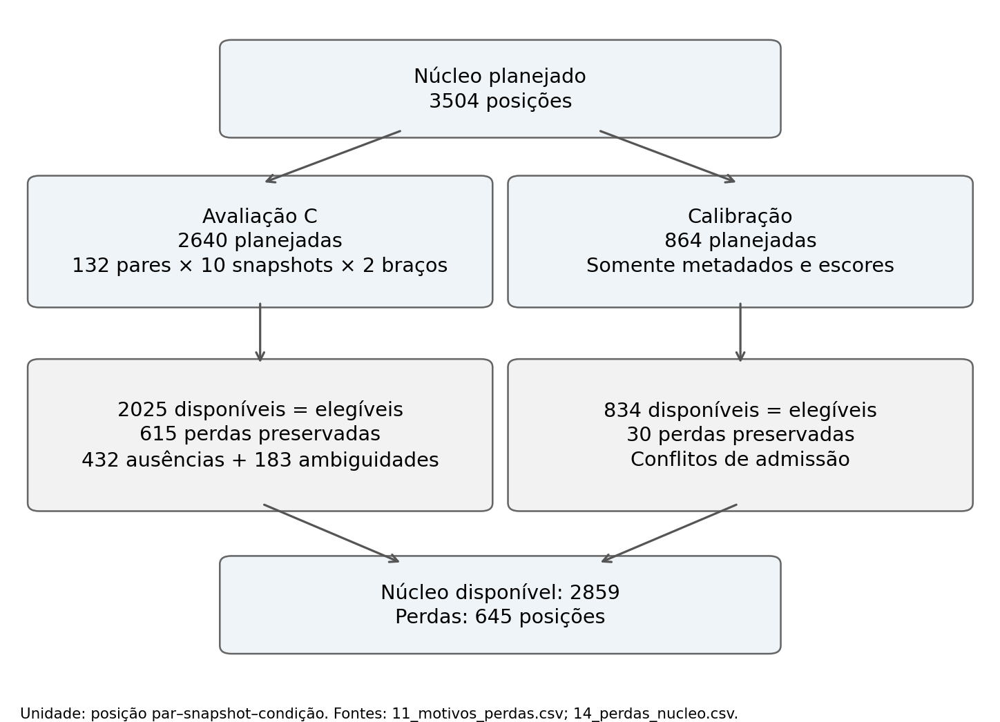
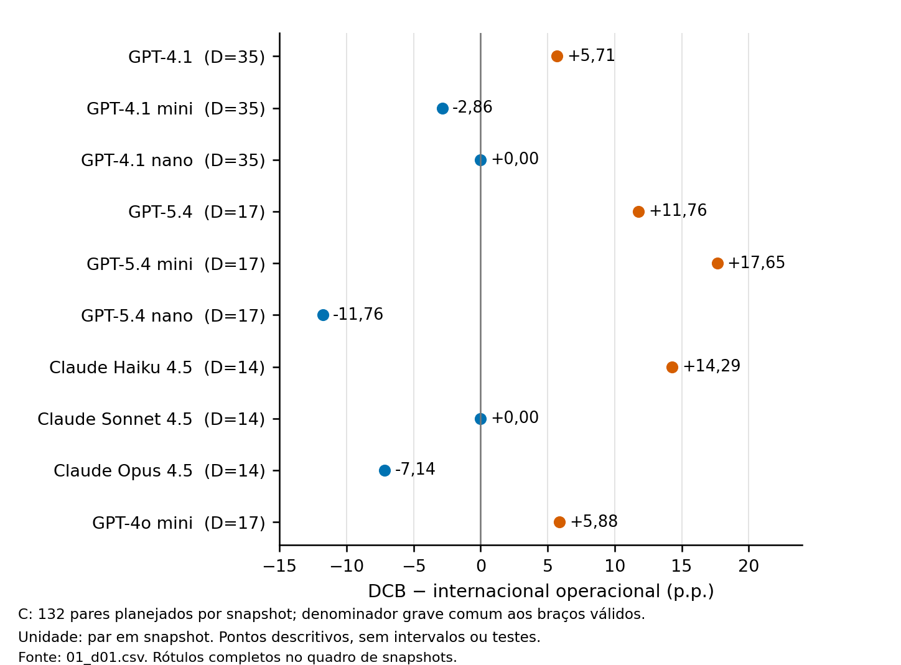
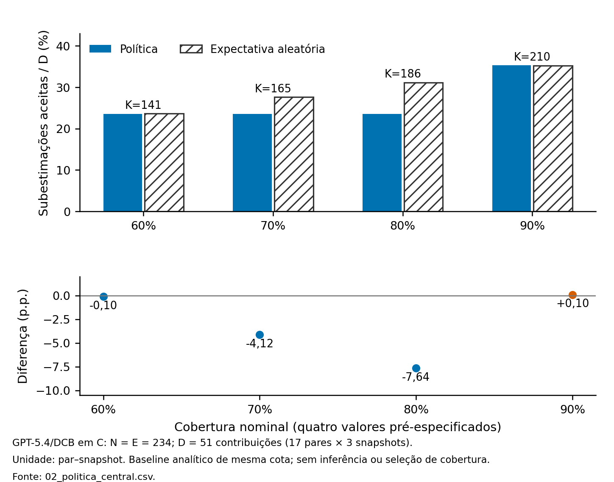
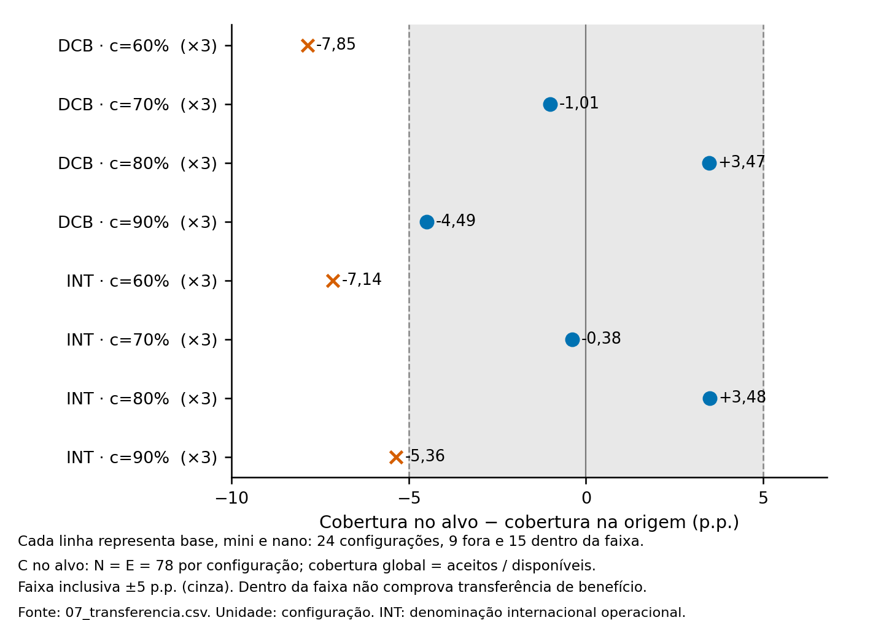

# Resultados em imagens

Gráficos e tabelas da avaliação retrospectiva e exploratória congelada, executada em **04/10/2026**. São **11 imagens em PNG: quatro gráficos e sete tabelas**. Os gráficos foram copiados da versão do manuscrito; as tabelas foram convertidas para imagem preservando os valores e o arredondamento apresentados no texto. Esta pasta não acrescenta experimentos ou reexecuta a avaliação.

As imagens podem ser abertas individualmente para ampliar ou baixar. Os arquivos com numeração igual em `figuras/` e `tabelas/` são distintos; siga os links abaixo.

## 1. População e perdas

Na avaliação C, foram planejadas **2.640 posições = 132 pares × dez snapshots × duas condições**. Permaneceram **2.025 observações disponíveis/elegíveis** e **615 perdas**: 432 ausências e 183 ambiguidades. A calibração utilizou somente metadados e escores. Indisponibilidade não foi tratada como erro nem como abstenção do modelo.

[Tabela: disponibilidade por snapshot e condição](tabelas/01_disponibilidade.png)

## 2. Nomenclatura antes da abstenção (D01)

O contraste é **DCB menos denominação internacional operacional**. Entre os dez snapshots, há cinco diferenças positivas, três negativas e duas zero. Não há direção uniforme. As populações pareadas diferem entre snapshots, portanto o gráfico não constitui uma classificação direta dos modelos na mesma amostra.

[Tabela completa: pares pareados, graves comuns, numeradores, taxas e diferenças](tabelas/02_nomenclatura_d01.png)

## 3. Política seletiva nas quatro coberturas

Na análise central GPT-5.4/DCB, a diferença entre a política e a expectativa aleatória de mesma cota foi **−0,10; −4,12; −7,64; +0,10 pontos percentuais**, nas coberturas nominais de 60%, 70%, 80% e 90%, respectivamente. As quatro coberturas são preservadas; não foi escolhida uma vencedora.

São **234 contribuições disponíveis = 78 pares × três snapshots**. O denominador grave é **51 contribuições = 17 pares × três snapshots**, não 51 pares independentes. O baseline é uma expectativa analítica de mesma cota, sem sorteios; seus numeradores esperados podem ser fracionários.

- [Tabela central: cotas, numeradores, denominadores e taxas](tabelas/03_politica_central.png)
- [Tabela: heterogeneidade entre os nove snapshots previstos para a política](tabelas/04_heterogeneidade_snapshots.png)
- [Tabela: estratos morfológicos derivados das decisões globais](tabelas/05_estratos_morfologicos.png)

Os estratos não receberam seleção ou cota próprias. Os snapshots Claude são replicações conceituais com protocolos históricos distintos; não foram agrupados com os modelos OpenAI.

## 4. Aplicação de limiares entre famílias

Foram aplicados os **24 limiares congelados GPT-4.1 → GPT-5.4**, sem recalibração ou imposição de cota no alvo. **Nove configurações ficaram inconclusivas por deriva de cobertura e 15 ficaram dentro da tolerância operacional**. Estar dentro da tolerância não comprova transferência de benefício.

Deriva = cobertura observada no alvo menos cobertura observada na origem. A tolerância é **±5 pontos percentuais, inclusive**; a comparação não é contra a cobertura nominal. As oito linhas operacionais abaixo se repetem em base, mini e nano, totalizando 24 configurações.

- [Tabela: cobertura global, cobertura entre elegíveis e deriva](tabelas/06_transferencia_cobertura.png)
- [Tabela completa: desfechos nas 24 configurações](tabelas/07_transferencia_desfechos.png)

## Como ler os denominadores

- **N / E / K:** disponíveis / elegíveis / aceitas. Posições planejadas e perdas são informadas separadamente.
- **D:** denominador grave da avaliação. D01 exige pares graves comuns aos dois braços; a política usa graves elegíveis; a transferência usa graves conhecidos disponíveis na base global.
- **u/D:** subestimações aceitas divididas pelo denominador grave completo.
- **u/Ga:** subestimações divididas somente pelos graves aceitos; é o risco entre graves aceitos.
- **e/K:** qualquer categoria incorreta dividida por todas as observações aceitas; é o erro residual.
- **D = 0:** resultado indefinido, nunca substituído por zero. As tabelas aqui apresentadas têm denominadores graves positivos.
- **INT:** denominação internacional operacional, sem estender a alegação estrita INN→DCB a toda a população.
- **Grave:** categoria da referência DDInter, não uma observação de dano em paciente. **p.p.** significa pontos percentuais.

## Fontes e limites

As fontes são os agregados do pacote `avaliacao_real_20261004_01a0c1bc/tabelas_v1/`, preservado no projeto original. Os gráficos e as tabelas de apresentação provêm de `paper/gerados_exploratorio_20261007/`. A identificação dos CSVs abaixo permite rastrear cada imagem; esses arquivos de origem não acompanham esta seleção pública.

| Conteúdo | Agregados de origem |
|---|---|
| Fluxo e perdas | `11_motivos_perdas.csv`; `14_perdas_nucleo.csv` |
| Disponibilidade | `10_disponibilidade.csv`; `14_perdas_nucleo.csv` |
| D01 (gráfico e tabela) | `01_d01.csv` |
| Política central (gráfico e tabela) | `02_politica_central.csv` |
| Heterogeneidade | `03_snapshots_openai.csv`; `04_claude_replicacao_conceitual.csv` |
| Estratos | `06_estratos_morfologicos.csv` |
| Transferência (gráfico e duas tabelas) | `07_transferencia.csv` |

Esta galeria apresenta os resultados principais e detalhamentos das três frentes; não substitui todo o pacote de avaliação. O inventário original contém 37 membros: **33 análises ativas e quatro sensibilidades adiadas naquela execução**. A sensibilidade documental **D01-E permanece não avaliável**, não um efeito nulo. Análises posteriores dos suplementos do artigo não fazem parte desta pasta.

Os resultados descrevem um benchmark finito, retrospectivo e exploratório. Poucos pares graves, repetição entre snapshots, perdas e protocolos históricos não plenamente equivalentes limitam a interpretação. Não há inferência, intervalos de confiança, testes de hipótese, alegação de superioridade populacional, causalidade exclusiva da nomenclatura ou segurança clínica. A referência documental não recebeu validação farmacêutica independente.

A pasta contém somente imagens de resultados agregados e esta explicação. Respostas brutas, registros individuais, caches e documentos internos de revisão não foram incluídos. Os avisos e o escopo do [LICENSE](../LICENSE) continuam preservados; esta adição não estabelece nova licença de redistribuição.
